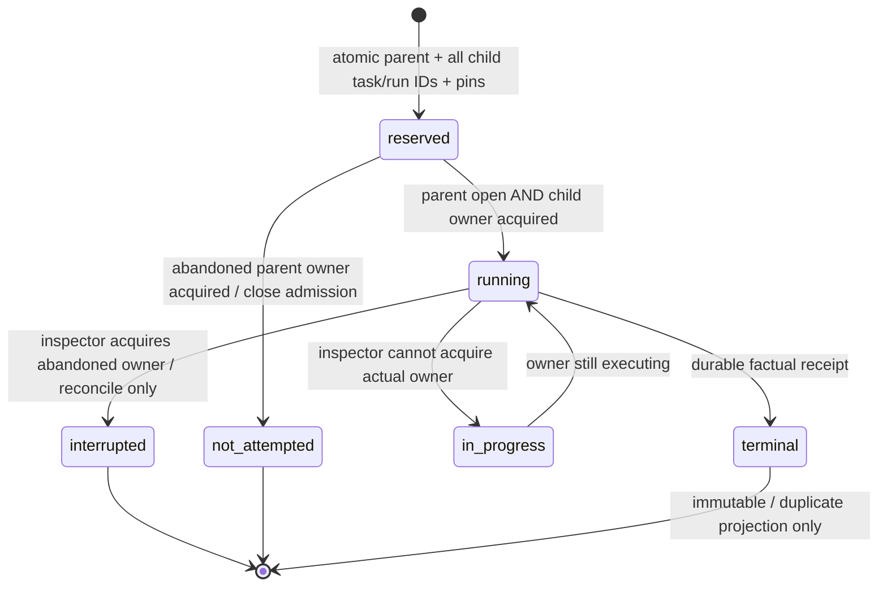
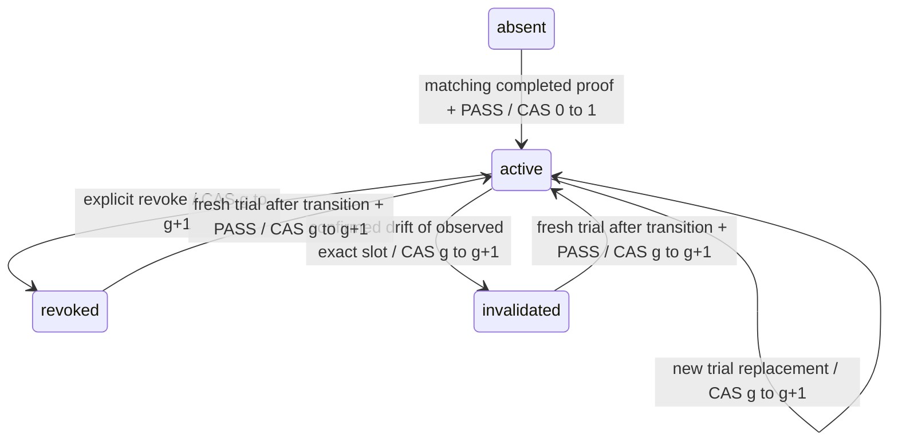
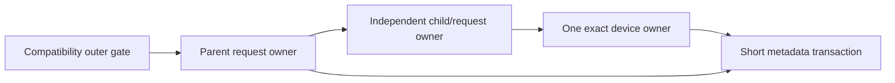
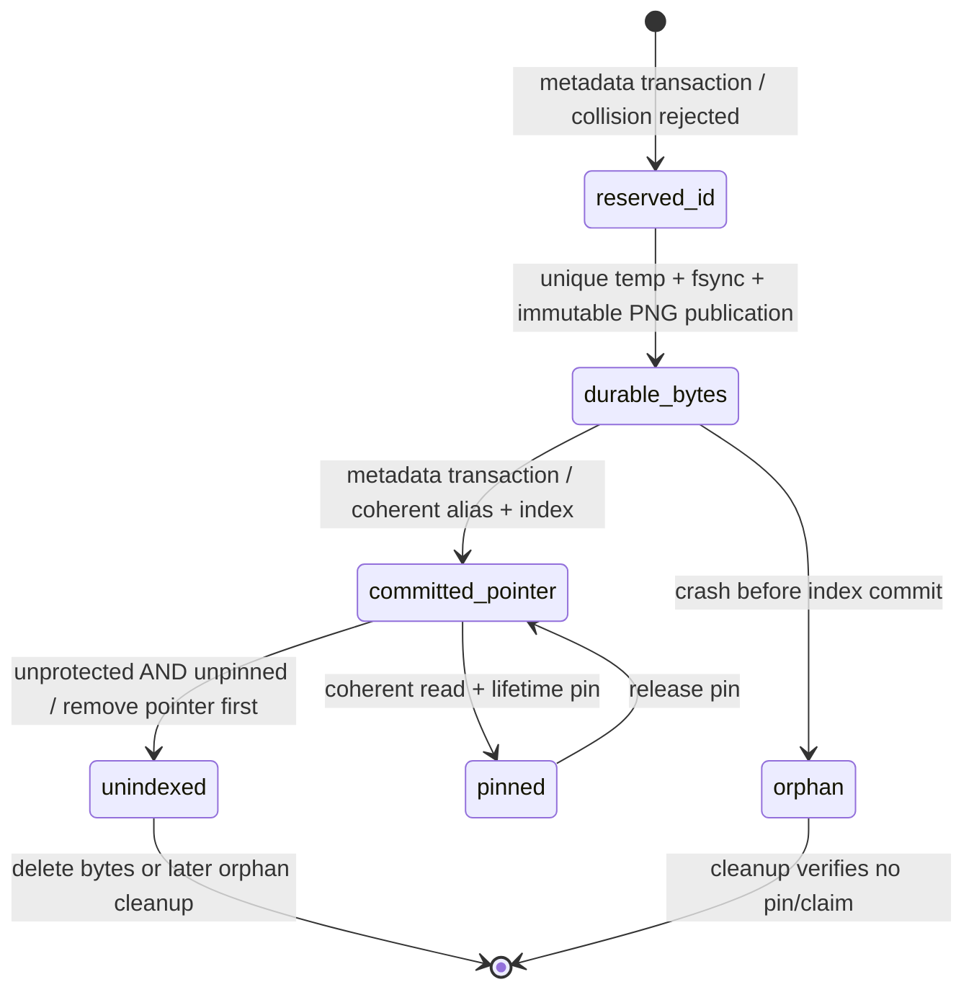

# C00 state and ownership freeze

These diagrams restate CONTRACT v1 K03–K06 and K08 amendment 1. They are design
oracles, not proof that production implements them. Compatibility outer gate
remains until C11, with quiescent old writers required for eventual migration.

Before pending intent: no effect for that step; earlier verified effects remain.
Pending intent and epoch increment commit before possible input. An abandoned
pending action is unknown and never replayed. Transport loss does not imply owner
death. A live child survives parent loss; reconciliation closes admission first,
marks reserved children not_attempted, then nonblocking checks each running owner.

Duplicate lookup precedes CAS and current online/generation validation, returning
the original mutation receipt with duplicate_request=true, without changing the
slot. Offline/unknown probe and restored profile do not change slot state. An old
probe cannot invalidate a newer replacement. Source proof enrolls only the source
serial on the first enrollment. Family CAS and slot CAS are independent; activation
never copies qualifications. Admissions pin both generations and immutable proof.

Never metadata → owner/device, child → parent, recursive owner acquisition, or
device A → wait for device B. A nested run/transition shares its admitted owner's
context. OS and process-local thread exclusion both required. Lock paths hash
canonical store + full ID/serial; do not unlink usable lock files. Portable wait
at most 2 seconds, legacy wait up to 120 seconds. No capture, sleep, polling,
network or OpenCV inside metadata. No input path bypasses device ownership.

Evidence snapshot: capture dependency revisions and pins under metadata, verify
bytes/proof outside metadata, compare revisions/seal at commit. Any cooperative
annotation/status/asset/ref/index mutation invalidates stale validation with
EVIDENCE_CHANGED. Portable templates are sealed bytes, never mutable aliases.
Each worker explicitly establishes its validation/protection context.

Batch status precedence is live reserved/running or surviving owner → in_progress;
all completed → completed; abandoned plus not_attempted/interrupted → interrupted;
some completed → partial; otherwise needs_agent. Counts sum all children; reserved
maps to in_progress before close. Busy/rejected children have factual not_attempted
outcome. Terminal receipts are immutable, and inspection never dispatches.

Request normalization uses UTF-8 canonical sorted compact JSON, defaults applied,
ordered arrays retained, NaN rejected; effect identity excludes return_image.
Golden child IDs are in ID_EXAMPLES.json. New kind prefixes are disjoint from
legacy run_/task_/trans_; a reserved child cannot be adopted by standalone execute.
